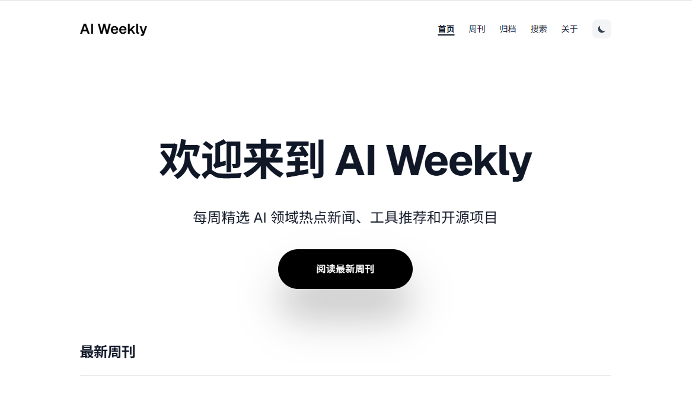

# AI Weekly · 中文 AI 周刊

每周精选人工智能领域值得关注的信息，覆盖模型与产品、国内动态、开源工具、科研进展和行业应用，帮助读者了解过去一周的 AI 变化。

项目基于 Astro 构建，使用 Markdown 管理周刊，生成可部署的静态网站。



## 内容与功能

- **每周精选**：每期以 8—12 条资讯为编辑目标，重要事件展开解读，结合新闻密度灵活调整。
- **明确时间范围**：按周整理，收录对应周内发布的公告、研究或活动信息。
- **可追溯来源**：保留原文链接，优先采用官方公告、项目仓库和论文。
- **一周观察**：结合当周动态，分析技术变化及其实际影响。
- **便捷阅读**：支持周刊归档、关键词搜索、标签筛选和 RSS 订阅。
- **阅读体验**：响应式布局、深浅色模式、文章目录与相邻周刊导航。

## 本地运行

### 环境要求

Node.js **22.12.0 或更新版本**，npm **9.6.5 或更新版本**；也可使用 pnpm。

### 获取项目并启动

```bash
git clone https://github.com/zhumengting01/AI-Weekly.git
cd AI-Weekly
npm install
npm run dev
```

打开本地地址：

- 首页：<http://localhost:4321/>
- 周刊列表：<http://localhost:4321/weekly/>
- 搜索：<http://localhost:4321/search/>
- RSS：<http://localhost:4321/rss.xml>

保持终端运行即可持续预览；修改文章后页面会更新。停止服务时按 `Ctrl+C`。如果默认端口被占用，以终端输出的地址为准。

项目已包含 `pnpm-lock.yaml`。使用 pnpm 时，可将安装和启动命令替换为 `pnpm install` 与 `pnpm dev`。

## 周刊更新方式

当前通过项目对话协助检索、核实与撰写，再将内容保存到 Markdown 文件。阅读、编辑和构建网站无需配置额外的大模型 API 密钥。

### 1. 确定新闻周期

以每周一整理上一周周一至周日的信息为常用安排，正文明确写出新闻覆盖日期。选题按信息的实际发布或发生时间归入对应周次，避免把旧消息当作当周新发布。

### 2. 核实来源并撰写

优先查阅发布方官网、官方仓库、论文及主办方资料。区分已上线功能、研究结果、测试计划与未来承诺；性能和成本数字注明厂商或研究的测试口径。

常用栏目如下，可按当周信息调整：

- 本周焦点：2—3 条重要动态。
- 模型与产品：模型发布、产品更新与开发工具。
- 国内动态与开源：国产模型、开源项目与社区进展。
- 科研与应用：研究论文、行业案例与实际落地。
- 一周观察：提炼当周趋势和使用启发。

### 3. 保存文章

周刊位于 `src/content/weekly/`，文件示例为 `ai-weekly-020.md`。填写实际日期与内容：

```markdown
---
title: "本期主题标题"
date: 2026-10-26
periodStart: 2026-10-19
periodEnd: 2026-10-25
excerpt: "一句话概括本期关注的模型、产品、开源或科研动态。"
tags: [AI, 周刊]
featured: false
takeaways:
  - "本期最重要的变化之一。"
  - "本期最重要的变化之二。"
  - "本期最重要的变化之三。"
readerFor: "关注该主题的读者"
sourcesCount: 8
---

本期回顾 **2026 年 10 月 19 日—10 月 25 日**的 AI 动态。

# 本周焦点

## 新闻标题

说明发布日期、事件要点和实际影响。

[阅读原文：发布机构 · 原文标题](https://example.com/original-announcement)

---

# 一周观察

结合本期事实，提炼值得关注的变化。
```

上方日期、主题和链接仅用于展示格式，发布前替换为对应周次的真实信息。图片可放入 `public/images/`，在正文中用 `/images/文件名` 引用。

网站按文章的 `date` 排序，并同时展示年度周标题和编辑标题；历史文件编号不完全对应时间顺序，维护时以正文新闻范围和 `date` 为准。`periodStart`、`periodEnd`、`updatedDate`、`editorNote` 与 `corrections` 均为可选字段，分别用于记录新闻范围、后续更新和编辑说明。`takeaways`、`readerFor` 与 `sourcesCount` 会用于首页导读和周刊详情的快速扫读。

### 4. 预览与检查

执行 `npm run dev`，检查文章日期、来源、目录、排版与链接，再执行以下发布检查：

```bash
pnpm check        # Astro 与 TypeScript 检查
pnpm check:content # 最新一期内容门槛检查
pnpm check:links  # 检查周刊中的外部来源链接
pnpm build        # 生成生产站点
```

旧的 API 自动生成与定时任务安装入口已停用，`npm run generate`、`npm run generate:dry` 和 `npm run setup-cron` 不属于当前更新流程。旧脚本保留在 `scripts/` 中供参考。

## 构建与部署

```bash
# 构建静态网站，输出到 dist/
npm run build

# 预览构建结果
npm run preview
```

将 `dist/` 中的静态文件部署至支持静态站点的托管服务。使用 Git 仓库连接部署时，常用构建配置为：

| 配置项 | 值 |
| --- | --- |
| 项目根目录 | `package.json` 所在目录 |
| 构建命令 | `npm run build` |
| 输出目录 | `dist` |

部署前，将 `astro.config.mjs` 的 `site` 与 `src/pages/rss.xml.js` 的 `site` 改为实际站点地址，保证页面规范链接、站点地图和订阅链接一致。

## 项目结构

```text
AI-Weekly/
├── public/                 # 静态资源与图片
├── src/
│   ├── components/         # 列表、卡片、目录及主题切换
│   ├── content/weekly/     # 周刊 Markdown 内容
│   ├── layouts/            # 页面与文章布局
│   ├── pages/              # 首页、归档、搜索、标签与 RSS
│   ├── styles/             # 全局样式
│   ├── utils/              # 日期与辅助函数
│   └── content.config.ts   # 内容集合与字段定义
├── scripts/                # 历史采集与生成脚本
├── docs/                   # 项目维护记录
├── astro.config.mjs        # 站点配置
└── package.json            # 项目依赖与运行命令
```

## 技术栈

Astro 6、TypeScript、Tailwind CSS 4、Markdown / MDX，以及 Astro RSS 与 Sitemap 集成。

## 模板致谢

页面基于 [Brook / BROOK 2](https://github.com/holger1411/astro-brook) 模板改造。原模板来自 [TemplateDeck](https://templatedeck.com/templates/brook2)，感谢原作者与开源社区。

## 反馈

发现内容错误、来源失效或页面问题，欢迎通过 [GitHub Issues](https://github.com/zhumengting01/AI-Weekly/issues) 反馈，并注明对应周刊和具体位置。
